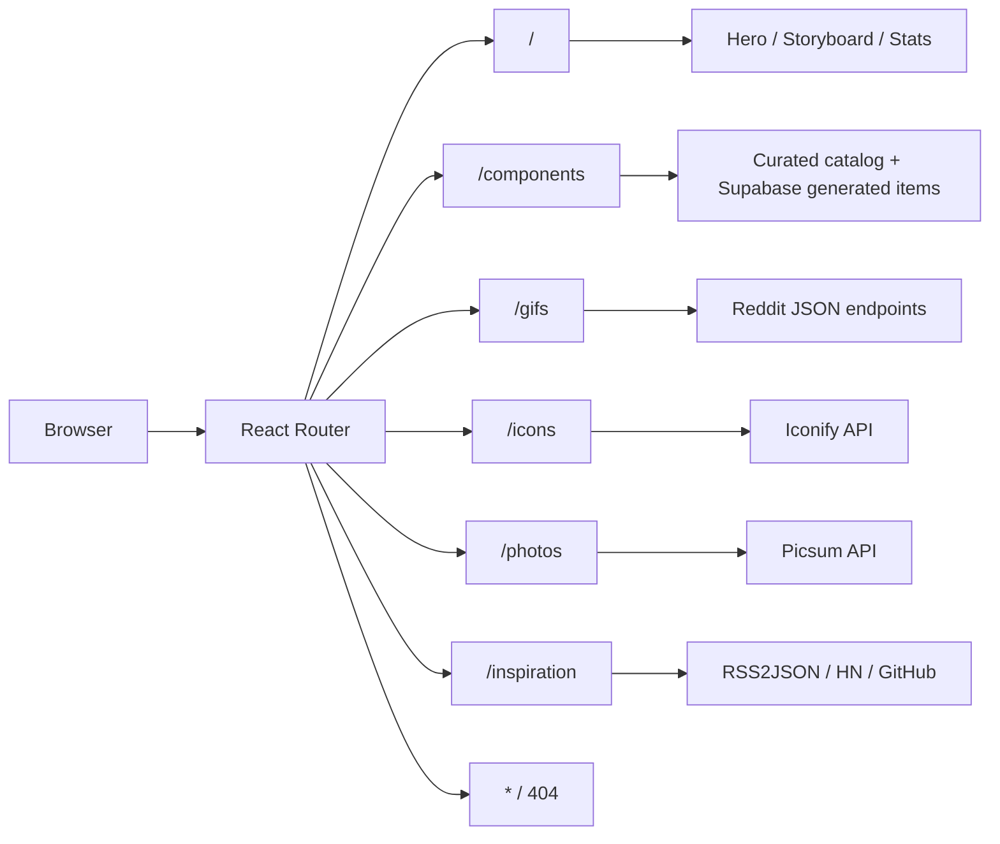
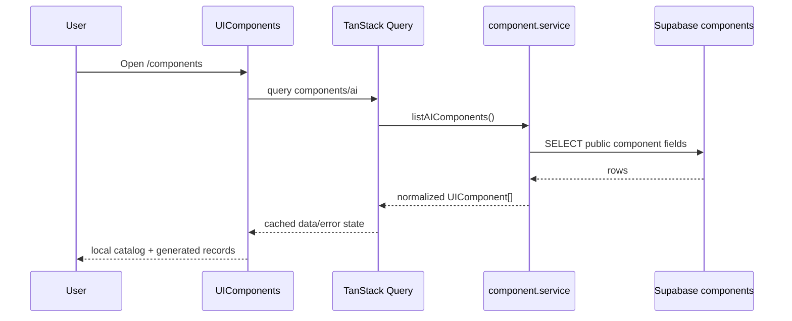
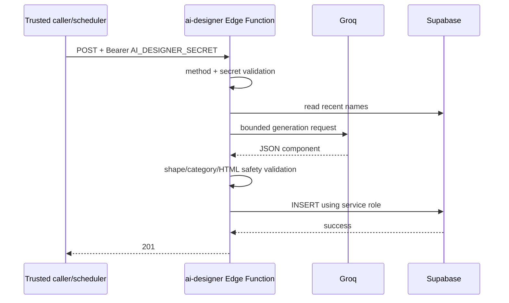
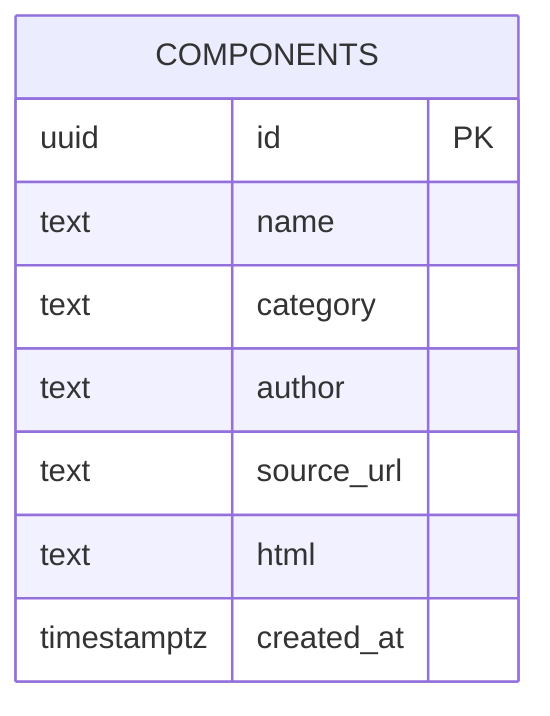
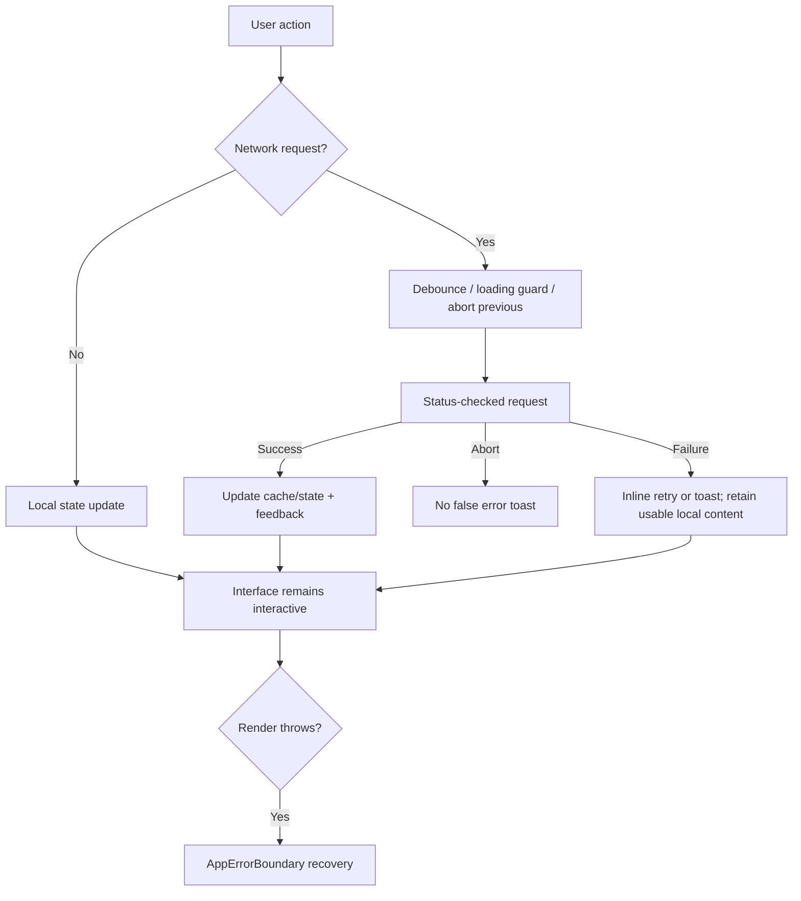
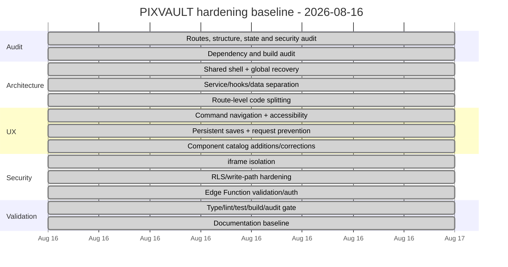

# PIXVAULT Engineering Documentation

**System:** PIXVAULT (`live-pixvault`)
**Architecture baseline:** 2026-08-16
**Runtime model:** client-rendered React SPA + external read APIs + Supabase database/Edge Function
**Primary design goal:** a fast, resilient, account-free resource vault for UI assets and frontend inspiration.

---

## 1. Executive summary

PIXVAULT is not a textbook server-rendered MVC application. It is better modeled as a **feature-oriented React SPA with layered separation of concerns**:

- **Routes/pages** compose feature screens.
- **Feature components** own presentation and short-lived interaction state.
- **Hooks** own reusable client-state behavior such as debouncing and persistent sets.
- **Services** own reusable remote I/O for Supabase, Iconify, Picsum, and generic HTTP behavior.
- **Data modules** own curated static catalog content.
- **Supabase** owns persistent generated components and the trusted AI-generation write path.
- **App providers** own cross-cutting concerns: routing, query cache, tooltips, toast surfaces, reduced-motion behavior, and global render recovery.

This is intentionally not forced into classic MVC terminology. For a React SPA, the current split gives stronger separation of concerns without adding artificial controller classes.

### Architecture assessment

| Area | Before hardening | Current baseline |
| --- | --- | --- |
| Route composition | Repeated page chrome | Shared `PageShell`, lazy routes |
| Server state | Ad-hoc fetches despite Query provider | React Query for component and icon server state; abortable fetches elsewhere |
| Static catalog | Mixed into a large controller/view file | Extracted to `src/data/componentCatalog.ts` |
| Supabase access | Client creation with empty-string fallback | Optional safe configuration + service boundary |
| Saved items | Memory-only Sets | `localStorage` persistence through `usePersistentSet` |
| Search | Manual timers / stale-request risk | Debounce hook and request cancellation where applicable |
| Clipboard/downloads | Fire-and-forget | Guarded errors and user feedback |
| Generated preview isolation | `allow-scripts allow-same-origin` | sandbox reduced to `allow-scripts` |
| Generated DB writes | Anonymous direct insert policy | public writes revoked; service-role Edge Function only |
| Global failures | No render boundary | `AppErrorBoundary` recovery |
| Accessibility | Hover-heavy, inconsistent focus | visible focus ring, touch-friendly actions, reduced-motion support, ARIA improvements |
| Dependency security | Audit findings | `npm audit` = 0 vulnerabilities |
| Initial bundle | ~843 KB monolithic route bundle | ~361 KB initial app chunk + lazy feature chunks |

---

## 2. Route map



All route modules are lazy-loaded with `React.lazy` and `Suspense`. The command menu (`Ctrl/Cmd + K`) provides global navigation.

---

## 3. Current file structure

```text
live-pixvault/
├─ src/
│  ├─ App.tsx                    # providers, lazy routing, route fallback
│  ├─ main.tsx
│  ├─ index.css                  # global tokens, focus/reduced-motion rules
│  ├─ pages/                     # route-level composition
│  ├─ components/
│  │  ├─ AppErrorBoundary.tsx
│  │  ├─ GlobalCommandMenu.tsx
│  │  ├─ PageShell.tsx
│  │  ├─ Navbar.tsx
│  │  ├─ Footer.tsx
│  │  ├─ UIComponents.tsx
│  │  ├─ GifShowcase.tsx
│  │  ├─ IconShowcase.tsx
│  │  ├─ IllustrationGallery.tsx
│  │  ├─ InspirationFeed.tsx
│  │  └─ ui/                     # shadcn/Radix primitives
│  ├─ data/
│  │  └─ componentCatalog.ts     # curated component definitions
│  ├─ hooks/
│  │  ├─ useDebouncedValue.ts
│  │  └─ usePersistentSet.ts
│  ├─ lib/
│  │  ├─ clipboard.ts
│  │  ├─ env.ts
│  │  ├─ supabase.ts
│  │  └─ utils.ts
│  ├─ services/
│  │  ├─ component.service.ts
│  │  ├─ http.ts
│  │  ├─ iconify.service.ts
│  │  └─ picsum.service.ts
│  ├─ types/
│  │  └─ resources.ts
│  └─ test/
│     └─ example.test.ts         # catalog integrity invariants
├─ supabase/
│  ├─ functions/
│  │  └─ ai-designer/index.ts
│  └─ migrations/
│     ├─ 20260527035257_create_components_table.sql
│     └─ 20260816023000_harden_component_writes.sql
├─ vite.config.ts
├─ vitest.config.ts
└─ package.json
```

`src/App.css` and the unused compatibility `NavLink` wrapper were removed as dead code.

---

## 4. Separation of concerns

### Presentation layer

`pages/` and `components/` render the experience. Route pages are intentionally thin and use `PageShell` for shared navbar/footer composition.

### Domain/data layer

`src/data/componentCatalog.ts` contains curated component records. Keeping catalog content outside `UIComponents.tsx` prevents content changes from touching pagination, querying, persistence, or card behavior.

### Service layer

- `component.service.ts`: Supabase component reads/counts.
- `http.ts`: status checking, timeout/cancellation, normalized HTTP errors.
- `iconify.service.ts`: Iconify search/SVG retrieval.
- `picsum.service.ts`: Picsum list/image URL behavior.

The remaining GIF and inspiration parsing is still colocated with those feature components. This is acceptable at the present complexity, but should be extracted if either feature acquires mutations, authentication, multiple consumers, or substantially more parsing logic.

### Reusable client-state layer

- `useDebouncedValue`: timing/debounce lifecycle.
- `usePersistentSet`: bookmark-like Set state persisted in `localStorage`.

### Infrastructure layer

- `lib/env.ts`: safe environment reading.
- `lib/supabase.ts`: optional client initialization.
- Supabase migration/Edge Function files: persistent data and trusted writes.

---

## 5. State ownership and use-state rules

PIXVAULT follows the rule that state should have one owner and derived values should not be duplicated.

| State | Owner | Persistence | Notes |
| --- | --- | --- | --- |
| Current route | React Router | URL | canonical navigation state |
| Supabase component list/count | TanStack Query | query cache | retry + stale time configured globally |
| Icon search results | TanStack Query | query cache | debounced query; request signal supported |
| GIF list/page token | `GifShowcase` | memory | stale requests cancelled with `AbortController` |
| Photo list/page | `IllustrationGallery` | memory | requests cancellable; duplicate actions guarded |
| Inspiration feed | `InspirationFeed` | memory + `sessionStorage` cache | source cache is optional/failure-tolerant |
| Saved components/GIFs/articles | `usePersistentSet` | `localStorage` | survives refresh; storage denial does not crash UI |
| Search/filter/page controls | feature component | memory | local UI state only |
| Reduced motion | Framer `MotionConfig` + OS preference | system | animations degrade automatically |

### Preventive interaction rules

- Expensive network actions are disabled or guarded while already loading.
- Debounced searches do not launch on every keystroke.
- Aborted requests do not show false error toasts.
- Copy/download actions surface success/failure.
- Route-level Suspense has an explicit loading fallback.
- Unknown render failures fall back to a full-app recovery boundary.

---

## 6. Data and request flows

### Component catalog read flow



If Supabase client variables are missing, the service returns an empty remote list and the curated local catalog remains usable.

### AI generated component write flow



The browser does **not** own the service-role key or AI designer secret.

### Icon search flow

Search text → debounced value → React Query key → Iconify service → cancellable/status-checked response → cards. Copy and download fetch the raw SVG and handle failure explicitly.

---

## 7. Database model and RLS

### Table



The original migration enabled RLS and allowed anonymous SELECT + INSERT. The hardening migration removes anonymous mutation capability:

```text
public/anon:
  SELECT -> allowed by existing RLS policy
  INSERT/UPDATE/DELETE -> revoked

trusted Edge Function:
  service role -> performs validated INSERT
```

This keeps the account-free read experience while preventing arbitrary public clients from directly filling the catalog with HTML.

### Deployment requirement

Apply the migration before relying on the new write-security model:

`supabase/migrations/20260816023000_harden_component_writes.sql`

The Edge Function must be configured with server-side secrets. `verify_jwt = false` is intentional only because the function enforces its own dedicated bearer secret; do not expose that secret to the frontend.

---

## 8. Security controls

1. **Generated HTML preview isolation**
   - iframe uses `sandbox="allow-scripts"` without `allow-same-origin`.
   - database HTML is not injected into the main application DOM.

2. **Generated HTML server validation**
   - rejects `<style>`, `<script>`, `<iframe>`, `<object>`, `<embed>`, `<meta>`, and `<base>`.
   - rejects `javascript:` URLs.
   - validates expected category, bounded name, and bounded HTML size.

3. **Database write restriction**
   - direct anonymous writes revoked.
   - service-role write is isolated to the Edge Function.

4. **Secret handling**
   - browser only sees `VITE_SUPABASE_URL` and `VITE_SUPABASE_ANON_KEY`.
   - service role, Groq key, and generator secret remain server-side.

5. **Network hardening**
   - reusable HTTP helper checks non-2xx responses and applies a timeout.
   - interactive searches support cancellation.
   - downloads check status before creating object URLs.

6. **Dependency hygiene**
   - React Router and Vite upgraded to patched current lines during this baseline.
   - `npm audit` reports zero vulnerabilities as of 2026-08-16.

The shadcn chart primitive contains a controlled `dangerouslySetInnerHTML` path for generated chart CSS from local configuration. It is not part of the generated component HTML pipeline.

---

## 9. UX and accessibility baseline

Implemented improvements:

- `Ctrl/Cmd + K` command navigation.
- route-level loading state.
- global render error recovery.
- branded 404 with SPA links.
- mobile navigation ARIA state (`aria-expanded`, `aria-controls`, explicit label).
- persistent bookmarks/saves.
- horizontal overflow handling for dense filter chips.
- visible focus styling.
- reduced-motion support via Framer Motion and CSS media query.
- touch-visible resource card actions instead of hover-only controls on smaller viewports.
- inline retry state where Supabase generated items fail.
- copy/download feedback and failure handling.
- disabled duplicate network actions during loading.

### Added/corrected catalog components

The manual catalog now includes practical patterns that were missing:

- Command Palette
- Responsive Action Drawer
- Sortable Data Table
- Validated Sign In Form
- Empty Collection State
- Inline Retry State

`Status Badge` was corrected from the `Buttons` category to `Badges`.

---

## 10. Performance baseline

Before route splitting, the production build emitted one initial JavaScript bundle of roughly **843 KB** minified.

After route-level lazy loading, the baseline build emits approximately:

- initial app chunk: **361 KB** minified / ~118 KB gzip
- homepage route: ~34 KB
- feature routes: ~5–10 KB each
- component catalog: separately loaded chunk (~272 KB)

The large static catalog is intentionally kept out of routes that do not use it.

Future optimization is only warranted if real-user performance data shows a need. The most obvious next target would be splitting the large static component catalog by category or loading it as structured data.

---

## 11. Error-handling strategy



Failures are handled as close as practical to their owner, while catastrophic render failures are caught at the app boundary.

---

## 12. Test and validation strategy

Current automated test invariants verify:

1. curated component identities are unique;
2. corrected/essential catalog entries exist in the expected categories;
3. catalog entries contain required metadata and a valid HTTP(S) source.

Required pre-merge/pre-release gate:

```bash
npx tsc --noEmit
npm run lint
npm run test -- --run
npm run build
npm audit
git diff --check
```

2026-08-16 result:
- TypeScript: PASS
- ESLint: PASS with 0 errors; 7 non-blocking shadcn Fast Refresh warnings
- Vitest: 3/3 PASS
- Vite production build: PASS
- npm audit: 0 vulnerabilities
- `git diff --check`: PASS

---

## 13. Implementation timeline

### Engineering timeline



Observed session checkpoints:
- **02:24 PHT** — Lynx scope/connection and audit started.
- **02:52 PHT** — first hardened production build validated.
- **02:59 PHT** — Vite/Router modernization and route splitting validated.
- **03:06 PHT** — meaningful catalog-invariant tests validated.

These timestamps are command/session checkpoints, not estimates of individual task duration.

---

## 14. Maintenance rules

### When adding a route

1. Add a lazy import and `<Route>` in `App.tsx`.
2. Use `PageShell` unless the route intentionally owns full-page chrome.
3. Add a command-menu destination if it is a primary resource.
4. Provide loading, empty, and error behavior.

### When adding a remote API

1. Put reusable I/O in `src/services`.
2. Use a typed response shape; avoid `any`.
3. Check HTTP status.
4. Support `AbortSignal` for search or changing filters.
5. Do not duplicate server data into multiple independent states.
6. Give the user a retry or stable fallback.

### When adding a curated component

1. Add it only to `src/data/componentCatalog.ts`.
2. Use a unique `(author, category, name)` identity.
3. Use the correct category.
4. Include a real `http(s)` source URL.
5. Keep the preview self-contained.
6. Run catalog invariant tests.

### When changing generated component writes

Do not re-enable anonymous INSERT. Keep generation behind the trusted Edge Function and validate output before database insertion.

---

## 15. Known boundaries / next sensible improvements

These are not current blockers:

- Extract Reddit and inspiration adapters into services if feature complexity grows.
- Split the static component catalog by category only if real-user performance data justifies it.
- Add browser-level route/a11y tests (Playwright) if this becomes a deployed product with regression requirements.
- Add observability for Edge Function failures/rate limits before automating high-frequency generation.
- Add a “Saved” unified route only if cross-resource saved-item browsing becomes a primary workflow.

The current baseline deliberately avoids authentication, account synchronization, and unnecessary backend complexity because PIXVAULT’s product promise is an account-free resource browser.

---

## 16. Notion documentation status

This file is the canonical documentation payload for the 2026-08-16 hardening baseline.

The connected Lynx runtime (`0.5.20-beta.9`) was checked before and after implementation. Its exposed tool surface currently includes local workspace/Git, GitHub, Vercel, Supabase, Neon, and Firebase actions, but **does not expose a Notion/external-MCP call tool**. Because the implementation was explicitly scoped to Lynx-only integrations, this documentation has not been published through a separate ChatGPT Notion connector.

When Lynx exposes its configured Notion MCP call tool, publish this document as the architecture/engineering page rather than maintaining a divergent copy.
