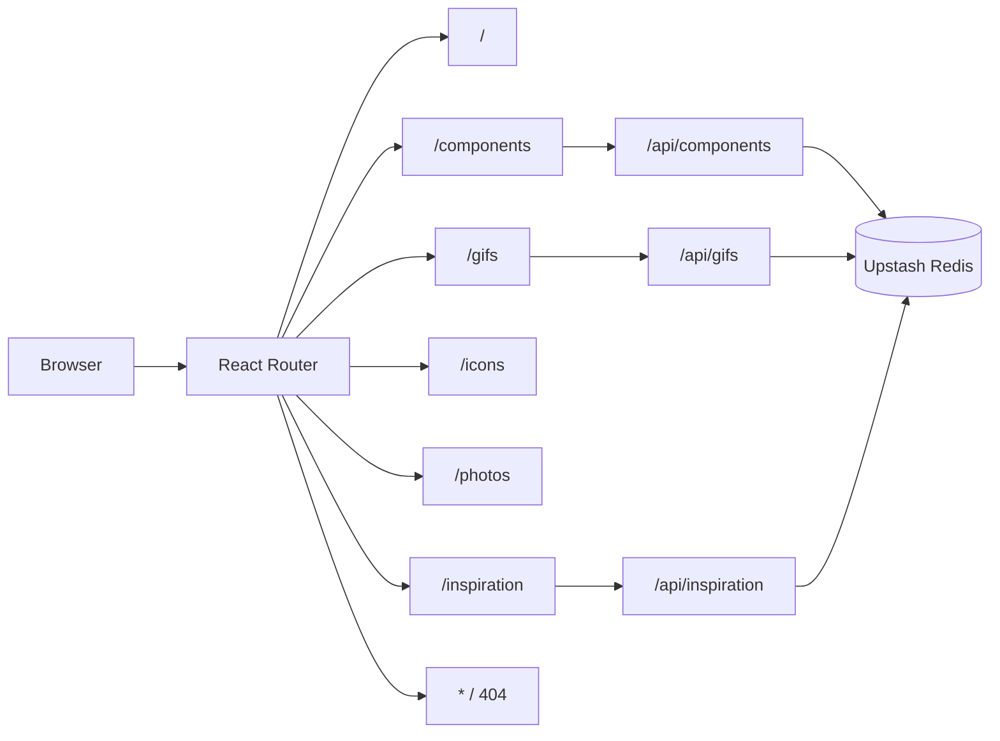
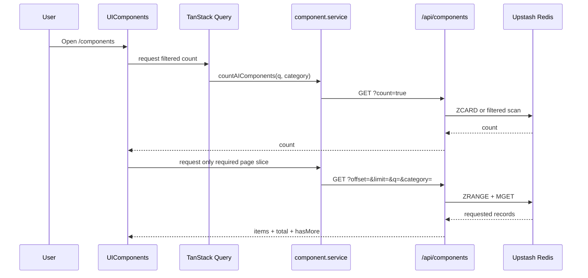
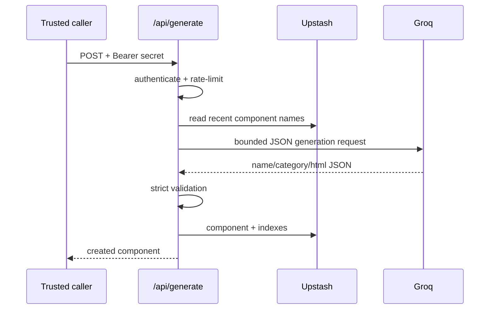
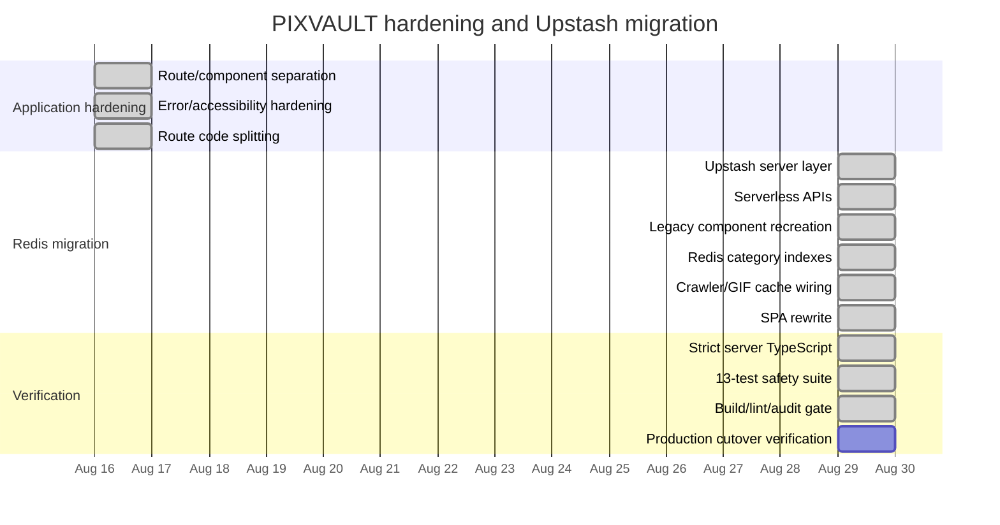

# PIXVAULT Engineering Documentation

**System:** PIXVAULT (`live-pixvault`)
**Architecture baseline:** 2026-08-29
**Runtime:** React SPA + Vercel Serverless Functions + Upstash Redis
**Primary goal:** an account-free resource vault that stays useful even when external providers are unavailable.

---

## 1. Product purpose

PIXVAULT collects practical frontend resources into one fast interface:

- copy-paste UI components
- GIF/animation references
- Iconify icons
- placeholder/editorial photos
- frontend/design inspiration feeds

The product is intentionally lightweight. Users do not need an account simply to browse, save locally, copy code, or download resources.

The architecture therefore prioritizes:

1. low operational cost
2. graceful degradation
3. safe handling of externally generated HTML
4. minimal browser-side secrets
5. simple maintenance
6. separation between curated content, cached external content, and generated/community content

---

## 2. Architecture decision

PIXVAULT is **not classic MVC**. For a React SPA, forcing controllers/models into MVC classes would add ceremony without improving boundaries.

The project follows a feature-oriented layered architecture:

```text
Routes / Pages
      |
      v
Feature Components
      |
      +--> Hooks / client state
      |
      +--> Services
              |
              v
        same-origin /api/*
              |
              v
       Vercel serverless
          /          \
         v            v
   Upstash Redis   External APIs
                      |
                      +-- RSS/Atom
                      +-- HN
                      +-- GitHub
                      +-- Reddit
                      +-- Stack Overflow
                      +-- optional Groq
```

### Separation of concerns

| Layer | Responsibility |
| --- | --- |
| `src/pages/` | route-level composition |
| `src/components/` | presentation and short-lived UI interaction state |
| `src/hooks/` | reusable browser-state lifecycle |
| `src/services/` | typed browser-to-server/resource I/O |
| `src/data/` | curated static component catalog |
| `api/` | Vercel serverless transport/controllers |
| `lib/` | server infrastructure, validation, Redis, auth, throttling |
| `scripts/` | migration, recovery, and controlled batch generation |
| Upstash Redis | durable component records, indexes, crawler cache, rate-limit counters |

---

## 3. Route map



All feature route modules are lazy-loaded with `React.lazy` and `Suspense`.

`vercel.json` explicitly rewrites application routes to `index.html`, fixing direct-load/refresh 404s without rewriting `/api/*`.

---

## 4. File structure

```text
live-pixvault/
├─ api/
│  ├─ components/
│  │  ├─ index.ts               # list/count/create components
│  │  └─ [id].ts                # read/delete one component
│  ├─ generate.ts               # protected Groq component generation
│  ├─ gifs.ts                   # Reddit GIF proxy/cache + local fallback
│  └─ inspiration.ts            # crawler/cache for design sources
│
├─ lib/
│  ├─ api.ts                    # typed request/response helpers
│  ├─ auth.ts                   # fail-closed bearer-secret guard
│  ├─ rate-limit.ts             # Upstash-backed fixed-window limit
│  ├─ redis.ts                  # lazy server-only Redis client + key schema
│  └─ sanitize-component.ts     # new + legacy HTML validation/recreation
│
├─ scripts/
│  ├─ migrate-supabase-to-redis.ts
│  ├─ rebuild-redis-components.ts
│  └─ recreate-components.ts
│
├─ src/
│  ├─ App.tsx
│  ├─ pages/
│  ├─ components/
│  │  ├─ UIComponents.tsx
│  │  ├─ GifShowcase.tsx
│  │  ├─ InspirationFeed.tsx
│  │  └─ ...
│  ├─ data/componentCatalog.ts
│  ├─ hooks/
│  │  ├─ useDebouncedValue.ts
│  │  └─ usePersistentSet.ts
│  ├─ services/
│  │  ├─ component.service.ts
│  │  ├─ iconify.service.ts
│  │  ├─ picsum.service.ts
│  │  └─ http.ts
│  ├─ types/resources.ts
│  └─ test/
│     ├─ example.test.ts
│     └─ redis-and-sanitization.test.ts
│
├─ supabase/                    # historical migration/function files only
├─ vite.config.ts               # Vite + same-process local API middleware
├─ vercel.json                  # SPA deep-link rewrites
├─ tsconfig.app.json
├─ tsconfig.node.json           # strict server/API/script checks
└─ package.json
```

The old browser runtime files `src/lib/supabase.ts` and `src/lib/env.ts` were removed during the Redis migration.

---

## 5. Upstash Redis data model

### Component record

```text
component:<id>
```

Value:

```json
{
  "id": "...",
  "name": "Aurora Glassbutton",
  "category": "Buttons",
  "author": "Groq AI Bot",
  "html": "<style>...</style><button>...</button>",
  "sourceUrl": "https://pixvault.dev/",
  "description": "...",
  "createdAt": "2026-08-03T19:00:03.807249+00:00",
  "provenance": "legacy-recreated"
}
```

### Global chronological index

```text
components:index
```

Type: Redis sorted set.
Member: component ID.
Score: component creation timestamp.

### Category indexes

```text
components:category:buttons
components:category:cards
components:category:empty-states
...
```

These avoid downloading every component when the UI filters by category.

### Crawler/cache keys

```text
crawler:hn
crawler:github
crawler:stackoverflow
crawler:reddit-webdev
crawler:gifs:gifs:hot:first
...
```

Feed caches use TTLs. Inspiration defaults to one hour; GIF cache defaults to 30 minutes.

### Rate-limit keys

```text
ratelimit:<scope>:<client>:<time-bucket>
```

They are short-lived and exist only to protect write/generation endpoints.

---

## 6. Component read flow

The component UI no longer downloads the complete database.



Curated local records are rendered first. Redis records fill the remaining page slots. This keeps the static curated library immediately usable even if Redis is temporarily unavailable.

---

## 7. Component write/generation flow

### Manual/community write

`POST /api/components` is not public-by-default.

```text
request
  -> bearer-secret guard
  -> Redis rate limit
  -> schema/category validation
  -> strict HTML validation
  -> Redis record
  -> global index
  -> category index
```

If neither `COMPONENT_WRITE_SECRET` nor `ADMIN_SECRET` is configured, the endpoint returns **503**. Missing configuration never means anonymous access.

### Delete

`DELETE /api/components/:id` requires `ADMIN_SECRET` or `COMPONENT_WRITE_SECRET` and also fails closed.

The handler removes:

1. `component:<id>`
2. member from `components:index`
3. member from its category index

### AI generation

`POST /api/generate` requires:

```text
AI_DESIGNER_SECRET
GROQ_API_KEY
```

Flow:



No AI-generation UI is exposed unless the server-side keys/secret are intentionally configured.

---

## 8. HTML safety model

PIXVAULT renders component previews with `iframe srcDoc`.

The iframe sandbox remains:

```text
allow-scripts
```

It intentionally does **not** include `allow-same-origin`.

The Tailwind CDN script used by the preview shell requires scripts, so stored/generated HTML itself must be sanitized independently.

### New components

New community/AI component HTML rejects:

- `<script>`
- `<iframe>`
- `<object>`
- `<embed>`
- `<meta>`
- `<base>`
- `<link>`
- `<applet>`
- `<style>`
- inline `on*=` event handlers
- `javascript:` URIs
- `data:text/html` URIs
- `action=`
- `formaction=`
- `srcdoc=`

New components are expected to use Tailwind utility classes.

### Legacy recreation

The original database was generated before these rules existed. Almost every legacy item contained a `<style>` block, and some included script/event behavior.

Deleting all styled records would have destroyed the catalog, so migration uses a separate **recreation** path:

1. remove `<script>` blocks
2. remove iframe/object/embed/applet content
3. remove document-level meta/base/link tags
4. remove inline `on*=` event handlers
5. remove form navigation/submission attributes
6. remove executable URI patterns
7. preserve safe legacy `<style>` blocks
8. remove CSS `@import`, `expression()`, executable URI schemes, `behavior`, and `-moz-binding`
9. run the rebuilt output through final safety assertions

If a record still fails validation, it is moved to a quarantine key and removed from the served index.

### Rebuild result on 2026-08-29

The live Upstash import initially contained 1,000 raw legacy records.

Before repair:

- 983 contained `<style>`
- 21 contained `<script>`
- 75 contained inline event handlers
- 89 contained at least one executable-pattern class checked during the audit
- 1,000 lacked provenance metadata

After `npm run redis:rebuild`:

- safely recreated: **1,000**
- quarantined: **0**
- executable-pattern rows remaining: **0**
- category indexes rebuilt: **13 populated legacy categories**
- provenance: `legacy-recreated`

---

## 9. Legacy Supabase migration status

Before the final cutover, the old Supabase table reported **2,004 component rows**.

During migration, 1,000 records reached Upstash. The old Supabase project then became unavailable:

- project REST hostname no longer resolves from the development environment
- the project ref is no longer returned by the connected Lynx Supabase account
- current accessible Supabase projects are unrelated projects

Therefore:

```text
known old count:       2,004
recovered in Upstash:  1,000
unavailable legacy:    1,004
```

The 1,004 missing rows are **not fabricated or silently replaced**. The migration/recovery script remains in the repository in case a valid backup or restored Supabase endpoint becomes available later.

The recovered 1,000 are the current durable community/archive dataset.

---

## 10. Inspiration crawler

The inspiration feature now goes through the server:

```text
Browser
  -> /api/inspiration?source=<source>
  -> Redis cache check
  -> external source on cache miss
  -> normalize
  -> store crawler:<source> with TTL
  -> return normalized items
```

Sources include:

- Reddit communities
- Stack Overflow
- GitHub repositories
- Hacker News
- CSS-Tricks
- Smashing Magazine
- Awwwards
- Codrops
- Dev.to
- web.dev
- A List Apart
- UX Collective

RSS/Atom feeds are fetched and parsed directly with `fast-xml-parser`; PIXVAULT no longer needs RSS2JSON for this server path.

This is a **request-triggered crawler/cache**, not a scheduled background crawler. A future Cron endpoint can pre-warm these same Redis keys without changing the UI contract.

### Failure behavior

- cached result available -> serve cache
- live fetch succeeds -> normalize + cache
- source fails with no cache -> API error -> UI retry state
- stale frontend requests -> cancelled/ignored using `AbortController`

---

## 11. GIF flow

```text
Browser
  -> /api/gifs
  -> Redis cache
  -> Reddit JSON on cache miss
  -> normalize media
  -> cache 30 minutes
```

Reddit may return 403/rate-limit server traffic. In that case the API returns the curated local files in:

```text
public/assets/gifs/
```

The GIF UI therefore remains usable rather than rendering a broken empty page.

Client requests are abortable, and an older request cannot clear the loading state of a newer request.

---

## 12. Browser state ownership

| State | Owner | Persistence |
| --- | --- | --- |
| route | React Router | URL |
| component counts/pages | TanStack Query | query cache |
| component filter/page | `UIComponents` | memory |
| icon results | TanStack Query | query cache |
| GIF results/token | `GifShowcase` | memory + server cache |
| inspiration result/source | `InspirationFeed` | memory + server cache |
| saved resources | `usePersistentSet` | `localStorage` |
| reduced-motion preference | Framer Motion / OS | system |

Derived values such as total pages and filtered local records are calculated rather than duplicated into state.

---

## 13. Error handling and preventive UX

### Application-level

`AppErrorBoundary` provides render recovery for unexpected React failures.

### Network-level

- non-2xx responses become explicit errors
- requests have bounded timeouts where supported
- GIF/inspiration stale requests are aborted
- copy/download operations report success/failure
- component library remains useful with static curated records if Redis fails
- GIFs have a bundled local fallback

### API-level

- invalid methods -> 405
- malformed component IDs -> 400
- invalid HTML/schema -> 400
- missing write secret -> 503
- bad bearer secret -> 401
- rate limit -> 429 + `Retry-After`
- missing AI provider key -> 503
- external provider error -> normalized 5xx response or documented local fallback

---

## 14. Local development

`npm run dev` uses Vite and a small development plugin that mounts the same handlers used under Vercel:

```text
/api/components
/api/components/:id
/api/generate
/api/gifs
/api/inspiration
```

This avoids maintaining a duplicate Express backend just for development.

The middleware has bounded JSON-body parsing and typed request/response bridging.

---

## 15. Environment/security boundary

### Required

```env
UPSTASH_REDIS_REST_URL=
UPSTASH_REDIS_REST_TOKEN=
```

These are server-side variables only.

Never use:

```env
VITE_UPSTASH_REDIS_REST_TOKEN=
```

The built frontend was checked and did not contain the Upstash URL/token.

### Optional mutations

```env
ADMIN_SECRET=
COMPONENT_WRITE_SECRET=
```

### Optional AI

```env
AI_DESIGNER_SECRET=
GROQ_API_KEY=
```

### Legacy recovery only

```env
LEGACY_SUPABASE_URL=
LEGACY_SUPABASE_ANON_KEY=
```

The legacy names intentionally do not use `VITE_`.

---

## 16. Vercel deployment

Production requirements:

1. Upstash Redis URL/token configured in Vercel
2. deploy repository branch containing `api/*`
3. `vercel.json` included
4. optional write/AI secrets configured only when those features are intentionally enabled
5. verify direct route loads
6. verify `/api/components?count=true`
7. verify generated client assets do not contain Redis credentials

Expected direct-route behavior after cutover:

```text
/             -> 200
/components   -> 200
/gifs         -> 200
/icons        -> 200
/photos       -> 200
/inspiration  -> 200
```

---

## 17. Quality gates

Run before every deployment:

```bash
npm run typecheck
npm run lint
npm test
npm run build
npm audit --omit=dev
git diff --check
```

2026-08-29 baseline:

| Gate | Result |
| --- | --- |
| frontend TypeScript | pass |
| server/API/scripts TypeScript | pass |
| ESLint | 0 errors; 7 shadcn Fast Refresh warnings |
| Vitest | 13/13 pass |
| Vite build | pass |
| npm audit | 0 vulnerabilities |
| diff whitespace | pass |
| Redis PING | PONG |
| rebuilt Redis component count | 1,000 |
| executable patterns after rebuild | 0 |

---

## 18. Maintenance commands

```bash
npm run typecheck
npm run redis:rebuild
npm run migrate:dry
npm run migrate:write
npm run components:generate -- 10
```

### `redis:rebuild`

Use after importing legacy records or when category indexes need to be regenerated. It is idempotent for safe records.

### `migrate:dry`

Reads a restored legacy Supabase source, recreates records in memory, and reports accepted/quarantined counts without writing Redis.

### `migrate:write`

Runs the same validation then persists accepted records and indexes to Redis.

### `components:generate`

Optional controlled batch generation through Groq. It requires a local/server `GROQ_API_KEY`; every result passes strict new-component validation before Redis persistence.

---

## 19. Operational invariants

Future changes should preserve these rules:

1. No database secret in browser-prefixed environment variables.
2. Browser code talks to same-origin APIs, not Redis directly.
3. New generated HTML never bypasses strict validation.
4. Legacy HTML never bypasses recreation/quarantine.
5. Mutations fail closed if their secret is absent.
6. Component browsing remains paginated.
7. Category writes update both global and category indexes.
8. Deletes remove all related indexes.
9. External-feed failures must not take down unrelated resource screens.
10. Direct SPA routes must continue working on production refresh.
11. `api/**`, `lib/**`, and `scripts/**` remain inside strict server TypeScript validation.
12. Documentation must distinguish current runtime architecture from historical migration code.

---

## 20. Implementation timeline



---

## 21. Known limitations / next sensible additions

- The request-triggered crawler is not yet pre-warmed by a scheduled Vercel Cron job.
- Reddit may reject server traffic; GIFs intentionally fall back to bundled curated files.
- AI generation is intentionally disabled until Groq + AI secret are configured.
- The unrecovered 1,004 historical Supabase records require an external backup/restored old project; PIXVAULT does not invent replacements while that source is unavailable.
- The seven remaining ESLint warnings are generated shadcn Fast Refresh export warnings and do not represent runtime defects.

The current production architecture should treat **Upstash Redis as the canonical persistent component store** and Supabase as historical migration context only.
